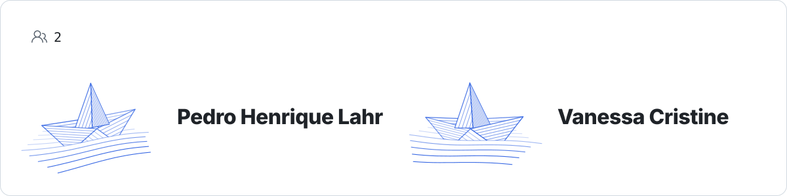

<a href="https://konecz.com">
  <picture>
    <source media="(prefers-color-scheme: dark)" srcset="https://raw.githubusercontent.com/konecz/konecz/output/cabecalho-escuro.svg?v=ling5">
    
  </picture>
</a>

**A Konecz é uma AI Factory: a fábrica de IA e software house IA-first de Curitiba, no Brasil.** Desenvolvemos
software com agentes de IA que escrevem, testam e revisam o código, enquanto pessoas decidem o que construir e
validam cada entrega. Também criamos influenciadores de IA e pesquisamos render de vídeo na GPU NVIDIA. Desde 2025.

**Konecz is an AI Factory: an AI-first software studio from Curitiba, Brazil.** AI agents write, test and review
the code; people decide what to build and sign off every release. We also create AI influencers and research GPU
video rendering.

  <a href="https://konecz.com">Site</a> ·
  <a href="#projetos">Projetos</a> ·
  <a href="#como-trabalhamos">Como trabalhamos</a> ·
  <a href="#perguntas-frequentes">Perguntas</a> ·
  <a href="https://konecz.com/en/">English</a>

<picture>
  <source media="(prefers-color-scheme: dark)" srcset="https://raw.githubusercontent.com/konecz/konecz/output/mar-escuro.svg?v=ling5">
  
</picture>

<picture>
  <source media="(prefers-color-scheme: dark)" srcset="https://raw.githubusercontent.com/konecz/konecz/output/linguagens-escuro.svg?v=ling5">
  
</picture>

<picture>
  <source media="(prefers-color-scheme: dark)" srcset="https://raw.githubusercontent.com/konecz/konecz/output/ritmo-escuro.svg?v=ling5">
  
</picture>

<picture>
  <source media="(prefers-color-scheme: dark)" srcset="https://raw.githubusercontent.com/konecz/konecz/output/tripulacao-escuro.svg?v=ling5">
  
</picture>

## Projetos

| Projeto | O que é | Onde |
|---|---|---|
| **Kodecz** | Motor de vídeo de código aberto (Apache-2.0): transforma uma página web (HTML, CSS, JavaScript) em MP4, quadro a quadro, na GPU NVIDIA (NVENC) ou em qualquer CPU (x264). Alternativa ao Remotion e ao HyperFrames, feita para agentes de IA | [konecz.com/kodecz](https://konecz.com/kodecz) |
| **remotion-gpu** | Exporta vídeos do Remotion na placa NVIDIA e deixa o processador livre: 4,1× menos CPU num vídeo de produção de 75 s. Código, benchmark aberto, paper e skill do Claude Code | [repositório](https://github.com/konecz/remotion-gpu) · [paper](https://konecz.com/blog/remotion-gpu) · [DOI](https://doi.org/10.6084/m9.figshare.34875540) |
| **Konectaz** | Fábrica de influenciadores de IA: cria o personagem (rosto, voz e personalidade) e produz os vídeos, do roteiro ao vídeo pronto para postar | [konecz.com/konectaz](https://konecz.com/konectaz) |
| **Vigia Pix** | Transparência das emendas parlamentares Pix: o caminho do dinheiro da União até a prefeitura, sempre com a fonte oficial. Laravel, React e PostgreSQL | [vigiapix.konecz.com](https://vigiapix.konecz.com) |
| **One for Coaches** | Sistema para treinadores de corrida e endurance: atletas, agenda, prescrição de treino e resultados. C#/.NET e PostgreSQL | [oneforcoaches.com](https://oneforcoaches.com) |

## Como trabalhamos

- **IA-first de verdade:** agentes de IA (Claude Code, Codex e outros) escrevem, testam e revisam o código; cada
  mudança passa por testes automáticos e por uma pessoa antes de ir para produção.
- **Infra própria:** nossos sistemas e a integração contínua rodam num servidor nosso, com GPU NVIDIA RTX 5090.
- **Stack escolhida por projeto:** TypeScript, Rust, Elixir/Phoenix, Ruby on Rails, C#/.NET, Python e PHP/Laravel,
  conforme o problema pede.
- **Pesquisa aberta:** publicamos método, dados e resultados negativos, como no paper do remotion-gpu.

## Perguntas frequentes

### O que é a Konecz?

A Konecz (Konecz Tecnologia e Inteligência Artificial LTDA) é uma AI Factory de Curitiba/PR: uma software house
IA-first que desenvolve sistemas sob medida com agentes de IA, cria influenciadores de IA e pesquisa render de vídeo
na GPU. Atua desde 2025.

### O que significa software house IA-first?

Significa que agentes de IA fazem a maior parte da escrita, dos testes e da revisão do código, e as pessoas da equipe
decidem o que construir e validam cada entrega. O resultado é software no ar mais rápido, sem abrir mão de testes e
revisão.

### Quem fundou a Konecz?

Pedro Henrique Lahr ([ORCID 0009-0001-2206-4852](https://orcid.org/0009-0001-2206-4852)) e Vanessa Cristine, que
também criaram o Kodecz.

### Onde fica a Konecz?

Em Curitiba, Paraná, Brasil.

### Como contratar a Konecz?

Pelo site [konecz.com](https://konecz.com) ou pelo e-mail [contato@konecz.com](mailto:contato@konecz.com).

Konecz Tecnologia e Inteligência Artificial LTDA · CNPJ 67.685.840/0001-06 · Curitiba/PR, Brasil ·
<a href="https://konecz.com">konecz.com</a> · <a href="https://konecz.com/llms.txt">llms.txt</a> ·
<a href="llms.txt">resumo para IA</a>

<a href="https://konecz.com"><b>konecz.com</b></a>

<!-- Cartões gerados por scripts/gerar.mjs com os números da API do GitHub, refeitos a cada 15 min e publicados no branch output. Fontes: Schibsted Grotesk e IBM Plex Mono (OFL, em fontes/). Logos: Simple Icons (CC0); ícones: Octicons (MIT), em icones/; a fita e o barco de papel vêm do konecz.com (scripts/origami.mjs). -->
