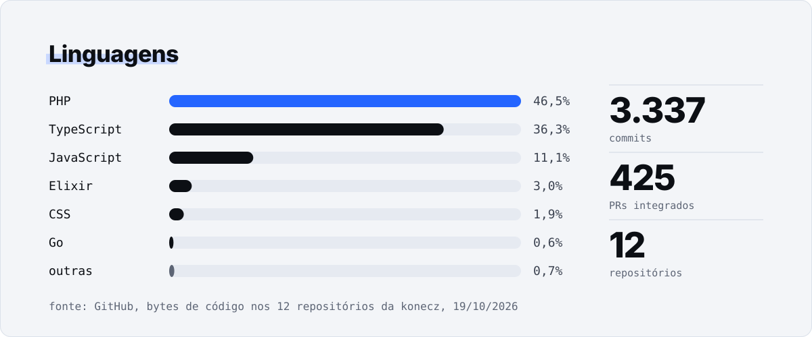
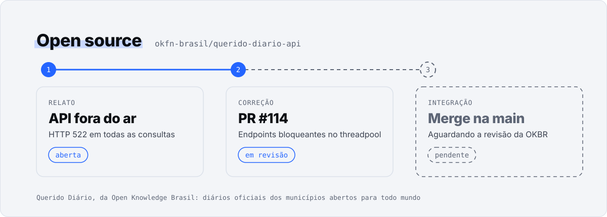

<a href="https://konecz.com">
  <picture>
    <source media="(prefers-color-scheme: dark)" srcset="assets/cabecalho-escuro.svg">
    
  </picture>
</a>

  <a href="https://konecz.com"><b>konecz.com</b></a>&nbsp;&nbsp;·&nbsp;&nbsp;<a href="https://www.instagram.com/konecz.oficial/">Instagram</a>&nbsp;&nbsp;·&nbsp;&nbsp;<a href="https://linkedin.com/company/konecz/">LinkedIn</a>&nbsp;&nbsp;·&nbsp;&nbsp;<a href="https://blog.konecz.com">Blog</a>&nbsp;&nbsp;·&nbsp;&nbsp;<a href="mailto:contato@konecz.com">contato@konecz.com</a>

<picture>
  <source media="(prefers-color-scheme: dark)" srcset="assets/linguagens-escuro.svg">
  
</picture>

<a href="https://github.com/okfn-brasil/querido-diario-api/pull/114">
  <picture>
    <source media="(prefers-color-scheme: dark)" srcset="assets/open-source-escuro.svg">
    
  </picture>
</a>

<picture>
  <source media="(prefers-color-scheme: dark)" srcset="assets/equipe-escuro.svg">
  
</picture>

<!-- Cartões gerados por scripts/gerar.mjs a partir de scripts/dados.json. Fontes: Schibsted Grotesk e IBM Plex Mono (OFL, em fontes/). -->
